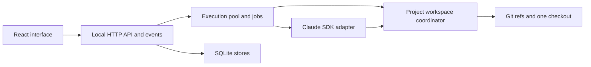

# Architecture

Bonsai is a modular monolith: one local Node.js server, SQLite, Git, and a React interface.
The server owns persistence, files, Git operations, and agent jobs. No separate services
are required for the current local application.

## Components

API routes live in `api/routes/`; domain rules, stores, Git, jobs, and storage are separate
server modules. UI code renders the API contract rather than implementing filesystem or
scheduling rules.

## Persistent state

| Entity | Purpose |
| --- | --- |
| Project | Repository identity, source snapshot, settings, and scratch location. |
| Experiment/node | Pinned code base, saved tip, lineage, conversation/session, and run history. |
| Workspace | Project's sole live checkout, active node, generation, hold, and switch journal. |
| Git ref | `refs/bonsai/<project>/<node>` keeps each saved tip reachable. |
| Local-file storage | `local-files/<node>` preserves non-disposable ignored data. |
| Save/recovery journals | Record exact operations that may finish after interruption. |

An experiment is a saved code version and conversation, not a permanent directory.
Git objects are shared. The active checkout contains all tracked files for its version.

A child pins its code base when created. Conversation inheritance is cut at the parent's
last completed session position; later parent work does not change that seed. Code and
conversation can therefore come from different ancestors when intermediate nodes have
no commits. Sessions belong to stable UUIDs and are mirrored into SQLite independently of cwd.

## Workspace activation and runs

1. The execution pool queues the job for the project's workspace and a global execution slot.
2. The coordinator acquires an OS-backed SQLite lock and checks ownership, refs, saved state,
   pending operations, Git locks, and unfinished files.
3. If another node owns the checkout, a hold blocks switching. Otherwise Bonsai records a
   durable switch intent, preserves local data, checks out the exact target commit, restores
   its retained files, and advances workspace ownership/generation.
4. A writable run prepares copy-in files and runs setup when needed. Declared ignored
   regeneratable artifacts are disposable; other ignored data stays node-specific.
5. The SDK works in the active checkout or the selected repository subdirectory.
6. Saving records an exact Git commit and durable database intent, then updates checkout
   and node refs using guarded Git operations. Saves must match the owning generation.
7. Process cleanup finishes before workspace ownership is released.

Questions, retries, setup, saves, and background cleanup retain the same project resource.
Jobs waiting for a workspace do not consume a global execution slot. Other projects and
independent committed-snapshot comparisons can proceed within the execution limit.

Running or opening a node's folder activates it. Opening also enables Keep active for
external use. Browsing saved conversations, Review, Apply, and Compare does not switch code.
Inactive reads use pinned commits, not the shared checkout's current HEAD.

## Repository adoption and Apply

For an existing Git repository, Bonsai shares its Git object store and adds managed refs
and checkouts while preserving the original checkout, index, and branches.
The adopted root is a fixed read-only snapshot, not a live mirror of the original folder.

A plain folder or repository without commits is snapshotted into private managed storage;
the source folder is not initialized or staged by Bonsai.
Optional unsaved-work snapshots use an isolated index and exclude ignored files.

Apply writes or downloads a patch. The user runs the application command and decides
what to commit; Bonsai does not merge into the original repository.

## Storage and compatibility

New projects use shared checkout. A project without a workspace row retains its previous
per-experiment worktrees until explicitly converted. Compatibility code and tests remain
necessary for existing installations; repository branch cleanup does not remove that support.

Conversion verifies owned checkouts and saved tips, records an immutable journal, preserves
unknown ignored files, and removes old managed folders only after preservation.
Setup reruns on switches or setup-configuration changes; there is no unverified sharing of
installed dependency environments.

Schema 29 prevents older builds from opening state they do not understand.
The database is backed up before migration, but that database-only backup is not a full
rollback of later Git/filesystem changes. Use a verified independent full backup.

## Safety boundaries

Dirty/staged/untracked files, unexpected Git identity, changed refs, unfinished saves,
held workspaces, and Git locks block unsafe mutations. Bonsai does not silently reset or stash.
Recovery preserves independent Git history and literal working/staged/ignored files before
restoring verified owned state.

Backups snapshot SQLite and copy independent Git objects, code, local files, sessions,
comparisons, and retained recovery data. They exclude authentication and arbitrary Git
remote/credential/hook configuration. Relocation verifies repository identity before repair.
Incomplete preparation, conversion, or recovery must finish before backup or relocation.

Worktrees provide code separation, not host isolation. Writable SDK tools and setup commands
have the host user's filesystem access. The Git command hook is cooperative, not arbitrary-code
containment. Read-only runs restrict SDK tools and skip setup, but are not an OS sandbox.

The server binds to loopback and checks request origins; it has no user authentication.
Do not expose it publicly. Process cleanup is bounded and cannot prove every external
process stopped, particularly on Windows.

## Previous design

See [the archived worktree architecture](archive/worktree-architecture.md) for the previous
allocation, run, setup, archive, and recovery flows and a pinned source reference.
See [development](development.md) for commands and [storage](storage.md) for user operations.
